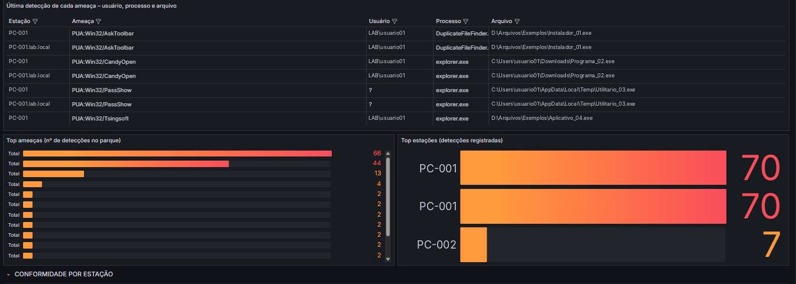
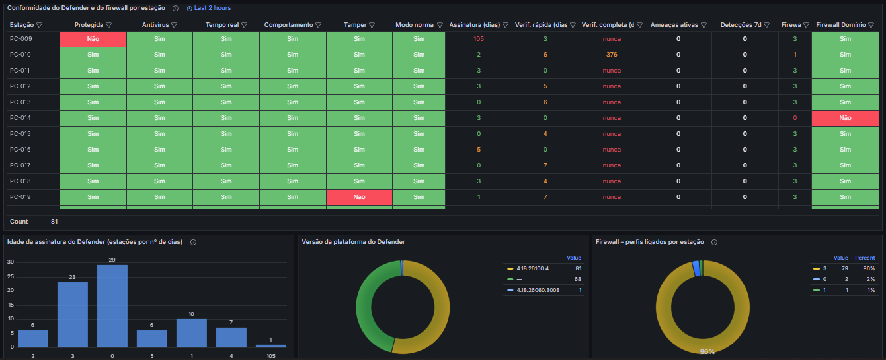
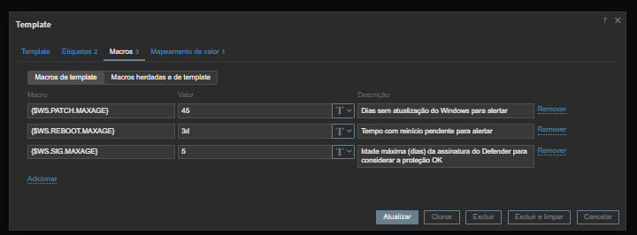
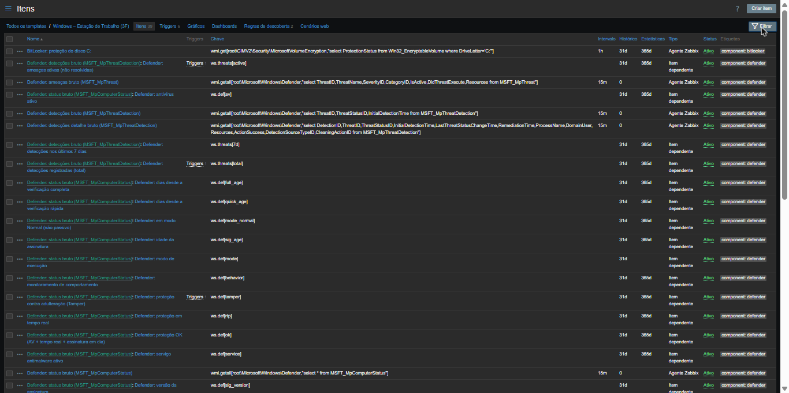
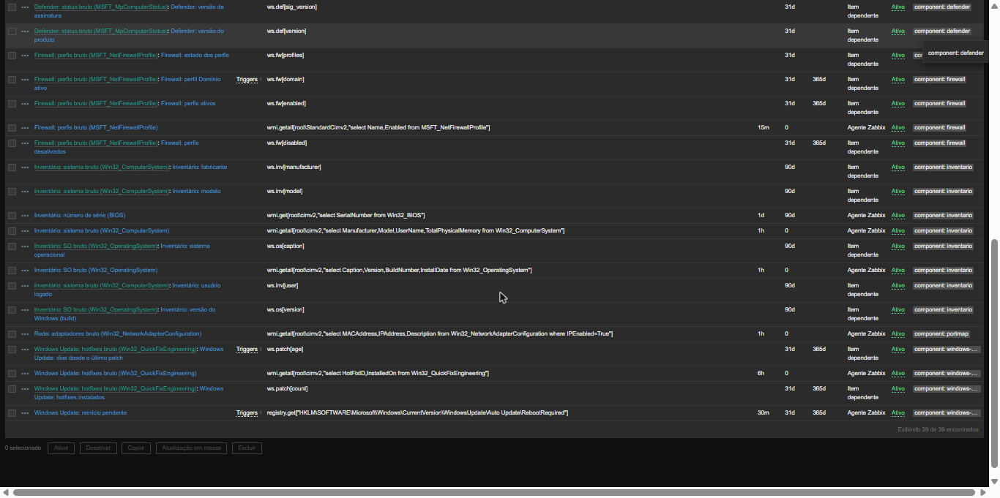
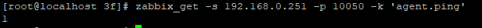
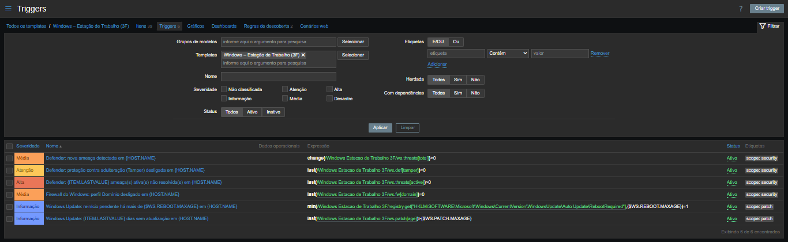
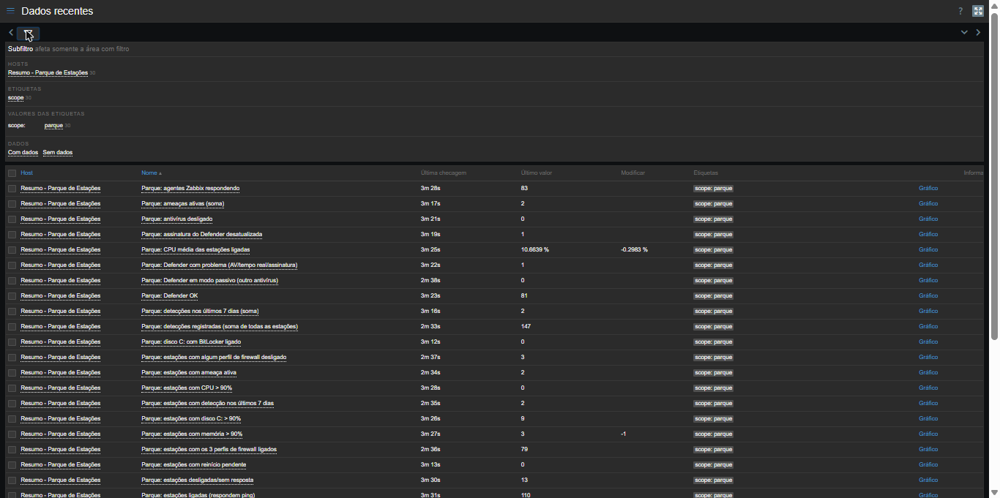
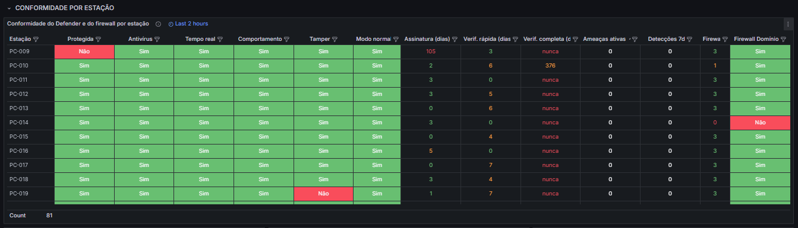

# zabbix-defender-baseline

**Monitoramento centralizado do Microsoft Defender e do Firewall do Windows com Zabbix e Grafana**
---

## Sumário

1. [Visão geral](#1-visão-geral)
2. [Por que o projeto existe](#2-por-que-o-projeto-existe)
3. [Arquitetura](#3-arquitetura)
4. [O que é monitorado](#4-o-que-é-monitorado)
5. [Economia frente a antivírus pago](#5-economia-frente-a-antivírus-pago)
6. [Conteúdo do repositório](#6-conteúdo-do-repositório)
7. [Variáveis do ambiente](#7-variáveis-do-ambiente)
8. [Implantação passo a passo](#8-implantação-passo-a-passo)
9. [GPOs](#9-gpos)
10. [Scripts PowerShell](#10-scripts-powershell)
11. [Operação do dia a dia](#11-operação-do-dia-a-dia)
12. [Indicadores de sucesso](#12-indicadores-de-sucesso)
13. [Limitações](#13-limitações)
14. [Rollback](#14-rollback)
15. [Narrativa de uso](#15-narrativa-de-uso)

---

## 1. Visão geral

| Item | Descrição |
|:--|:--|
| Objetivo | Visibilidade e governança do antivírus e do firewall nativos do Windows em todo o parque |
| Proteção | Microsoft Defender Antivírus + Firewall do Windows (já inclusos no Windows 10/11 e no Windows Server) |
| Coleta | Zabbix Agent 2 lendo WMI do Windows (`wmi.get` / `wmi.getall`), sem scripts de coleta na estação |
| Processamento | Zabbix Server: itens dependentes, itens calculados e triggers |
| Visualização | Grafana + plugin Zabbix (dashboard "Segurança – Antivírus e Firewall") |
| Padronização | GPO do Active Directory |
| Custo de licença | Zero |
| Versões de referência | Zabbix 7.4, Grafana 11.6, Windows 10/11, Windows Server 2016+ |

---




## 2. Qual é a ideia?

O Windows já traz um antivírus completo, o **Microsoft Defender Antivírus**, e um **firewall** nativo. Na maioria dos ambientes o que falta é visibilidade e governança, não proteção:

- Não há como saber, de forma central, quais máquinas estão com o antivírus desligado, com a proteção em tempo real desativada, com assinatura desatualizada ou sem verificação recente.
- Ameaças detectadas ficam só no log local da estação, e ninguém da TI é avisado.
- Não há controle se os três perfis do firewall (Domínio, Privado, Público) estão ligados.
- A alternativa de mercado é comprar uma suíte de antivírus corporativo, paga por estação e por ano, muitas vezes só para ter o console central.

O projeto resolve isso com ferramentas: Zabbix e o Grafana, e a GPO do Active Directory para padronizar a configuração.

### Objetivos

1. Garantir que 100% das estações tenham antivírus ligado, proteção em tempo real ativa e assinatura em dia.
2. Saber em minutos quando uma ameaça é detectada, em qual estação, e se foi tratada.
3. Garantir o firewall do Windows ligado nos três perfis.
4. Ter uma visão única do parque e uma lista das "estações desprotegidas e o motivo".
5. Fazer tudo isso sem custo de licença.

---


**OBS**: Este projeto não tem como objetivo substituir antivírus corporativos pagos, mas oferecer uma alternativa de monitoramento para empresas que ainda não possuem orçamento para investir em soluções de segurança mais completas. Antivírus corporativos geralmente oferecem recursos avançados de proteção, gerenciamento e resposta a ameaças, sendo recomendados sempre que possível. O objetivo é demonstrar que, mesmo com recursos limitados, é possível melhorar a segurança e a visibilidade do ambiente, enquanto a empresa não consegue investir em soluções corporativas mais avançadas.


## 3. Arquitetura

```
 Estações Windows (dominio.local)                  Servidor de monitoramento
 ┌───────────────────────────────┐   TCP 10050      ┌─────────────────────────────┐
 │ Microsoft Defender + Firewall │ ◄─────────────── │ Zabbix Server 7.4           │
 │ Zabbix Agent 2 (LocalSystem)  │   (passivo)      │  • Template "Windows –      │
 │  lê WMI:                      │                  │    Estação de Trabalho"     │
 │  root\Microsoft\Windows\      │                  │  • Host "Resumo - Parque    │
 │    Defender (MSFT_Mp*)        │                  │    de Estações" (calculado) │
 │  root\StandardCimv2           │                  │  • Triggers → notificações  │
 │    (MSFT_NetFirewallProfile)  │                  └──────────────┬──────────────┘
 └───────────────────────────────┘                                 │ API
          ▲                                                        ▼
          │ GPO (Active Directory)                  ┌─────────────────────────────┐
          │  • linha de base do Defender            │ Grafana 11.6 + plugin Zabbix│
          │  • firewall com 3 perfis ligados        │  Dashboard "Segurança –     │
          │  • regra de entrada TCP 10050           │  Antivírus e Firewall"      │
          │  • instalação do agente                 └─────────────────────────────┘
```

**Fluxo:**

1. A GPO instala o agente, liga o Defender e o firewall e libera a porta 10050 só para o servidor Zabbix.
2. O Zabbix consulta o WMI de cada estação a cada 15 minutos.
3. Os dados viram indicadores por estação (itens dependentes) e do parque inteiro (itens calculados).
4. As triggers geram alertas e o Grafana mostra o painel.

---




## 4. Monitoramento

### 4.1 Coleta por hosts (template "Windows – Estação de Trabalho")

| Origem (WMI) | Intervalo | Indicadores |
|:--|:--|:--|
| `MSFT_MpComputerStatus` | 15 min | Serviço, antivírus, tempo real, monitor de comportamento, modo (normal/passivo), idade da assinatura, idade da verificação rápida e completa, Tamper Protection |
| `MSFT_MpThreatDetection` / `MSFT_MpThreat` | 15 min | Detecções registradas, ameaças ativas, nome e severidade |
| `MSFT_NetFirewallProfile` | 15 min | Perfis Domínio, Privado e Público ligados |
| `Win32_EncryptableVolume` | 1 h | BitLocker no disco C: |
| `Win32_QuickFixEngineering` / registro do Windows Update | 6 h / 30 min | Dias sem atualização, reinício pendente |

Cada consulta WMI é feita uma única vez e alimenta vários **itens dependentes** (pré-processamento no servidor). Isso mantém baixo o custo para a estação e para a rede.

Itens principais (`ws.def[...]`): `av`, `rtp`, `behavior`, `service`, `mode`, `mode_normal`, `sig_age`, `quick_age`, `full_age`, `ok`.

### 4.2 Alertas (triggers do template)

| Severidade | Trigger |
|:--|:--|
| Alta | Defender: N ameaça(s) ativa(s) |
| Média | Defender: nova ameaça detectada em {HOST.NAME} |
| Média | Firewall do Windows: perfil Domínio desligado |
| Aviso | Defender: proteção contra adulteração (Tamper Protection) desligada |
| Informação | Windows Update: N dias sem atualização |
| Informação | Windows Update: reinício pendente |

### 4.3 Macros do template




| Macro | Padrão | Significado |
|:--|:--|:--|
| `{$WS.SIG.MAXAGE}` | 5 | Dias para considerar a assinatura do Defender desatualizada |
| `{$WS.PATCH.MAXAGE}` | 45 | Dias sem Windows Update para alertar |
| `{$WS.REBOOT.MAXAGE}` | 3d | Tempo com reinício pendente para alertar |


### 4.5 Dashboard no Grafana

"Segurança – Antivírus e Firewall (Windows Defender)"


---

## 5. Economia frente a antivírus pago

Além de melhorar o acompanhamento da segurança dos computadores, este projeto permite reduzir os gastos com licenças de antivírus, aproveitando ferramentas que a empresa já possui.

O Windows Defender e o Firewall já estão incluídos no Windows. Com o Zabbix e o Grafana, conseguimos acompanhar a proteção dos computadores de forma centralizada, sem precisar contratar uma ferramenta adicional apenas para esse monitoramento.

### 5.1 Como calcular

```
Economia anual = número de estações × preço por estação/ano da solução que seria contratada
```

A economia depende da quantidade de computadores e do valor que seria gasto com uma solução paga.

Por exemplo, se uma empresa possui 100 computadores e um antivírus custa R$ 150 por computador ao ano, o gasto seria de R$ 15.000 anuais.

Com este projeto, não existe custo adicional de licenciamento das ferramentas utilizadas. Os principais custos são o tempo de trabalho da equipe de TI e a infraestrutura de monitoramento, que normalmente já faz parte do ambiente da empresa.

### 5.2 Comparação básica de preço por estação/ano

| Solução paga | Custo/estação/ano |
|:--|--:|
| Kaspersky Endpoint Security | R$ 100 – 220 |
| ESET PROTECT Entry | R$ 137,08 (R$ 685,40 por 5 dispositivos) |
| ESET PROTECT (faixa) | R$ 130 – 280 |
| Bitdefender GravityZone | R$ 120 – 250 |
| Sophos Intercept X | R$ 180 – 350 |
| Microsoft Defender for Business | US$ 36 (US$ 3 por usuário/mês) |


### 5.3 Exemplo para 100 estações

| Solução paga | 1 ano | 3 anos |
|:--|--:|--:|
| Kaspersky Endpoint Security | R$ 10.000 – 22.000 | R$ 30.000 – 66.000 |
| ESET PROTECT Entry | R$ 13.708 | R$ 41.124 |
| Bitdefender GravityZone | R$ 12.000 – 25.000 | R$ 36.000 – 75.000 |
| Sophos Intercept X | R$ 18.000 – 35.000 | R$ 54.000 – 105.000 |
| Microsoft Defender for Business | US$ 3.600 | US$ 10.800 |
| **Este projeto** | **R$ 0 em licença** | **R$ 0 em licença** |

---

## 6. Repo

```
zabbix-defender-baseline/
├── README.md                                  # este documento
├── grafana/
│   └── dashboard-seguranca-antivirus-firewall.json
├── zabbix/
│   ├── template-windows-estacao-de-trabalho.yaml
│   ├── host-resumo-parque-de-estacoes.yaml
│   └── zabbix_agent2.conf.exemplo
├── scripts/powershell/
│   ├── Install-ZabbixAgent2.ps1
│   ├── Set-DefenderFirewallBaseline.ps1
│   ├── Test-DefenderZabbix.ps1
│   └── Invoke-DefenderRemediacao.ps1
├── gpo/
│   └── New-GPO-SegurancaEstacoes.ps1
└── env/
    └── exemplo.env                            # variáveis do ambiente (seção 7)
```


---

## 7. Variáveis do ambiente para Deploy

| Variável | Exemplo | Onde é usada |
|:--|:--|:--|
| `ZABBIX_SERVER` | `10.0.0.10` | Agente, GPO (regra de firewall) e scripts |
| `ZABBIX_URL` | `http://10.0.0.10/zabbix/api_jsonrpc.php` | Datasource do Grafana |
| `GRAFANA_URL` | `http://10.0.0.10:3000` | Importação do dashboard |
| `AD_DOMAIN` | `dominio.local` | GPO e Hostname (FQDN) |
| `AD_OU_PILOTO` | `OU=Piloto,OU=Estacoes,DC=dominio,DC=local` | Vínculo da GPO no piloto |
| `AD_OU_ESTACOES` | `OU=Estacoes,DC=dominio,DC=local` | Vínculo da GPO no parque |
| `ZBX_HOST_GROUP` | `Estacoes-Windows` | Grupo de hosts e macro `{$WS.GROUP}` |
| `ZBX_HOST_METADATA` | `Windows-Estacao` | Autorregistro |
| `AGENT_MSI_PATH` | `\\dominio.local\NETLOGON\Zabbix\zabbix_agent2-7.4.x-windows-amd64-openssl.msi` | GPO de instalação |
| `GRAFANA_DS_UID` | UID do datasource Zabbix | JSON do dashboard |

Exemplo de `env/exemplo.env`:

```ini
ZABBIX_SERVER=10.0.0.10
ZABBIX_URL=http://10.0.0.10/zabbix/api_jsonrpc.php
GRAFANA_URL=http://10.0.0.10:3000
AD_DOMAIN=dominio.local
AD_OU_PILOTO=OU=Piloto,OU=Estacoes,DC=dominio,DC=local
AD_OU_ESTACOES=OU=Estacoes,DC=dominio,DC=local
ZBX_HOST_GROUP=Estacoes-Windows
ZBX_HOST_METADATA=Windows-Estacao
AGENT_MSI_PATH=\\dominio.local\NETLOGON\Zabbix\zabbix_agent2-7.4.x-windows-amd64-openssl.msi
GRAFANA_DS_UID=<uid-do-datasource-zabbix>
```

---

## 8. Deploy

1. Zabbix.
2. Grafana.
3. GPO.
4. Estações piloto.
5. Parque inteiro.

### 8.1 Server Zabbix

**Importar o template**

1. Em *Data collection → Templates → Import*, envie `zabbix/template-windows-estacao-de-trabalho.yaml`.
2. Marque *Create new* e *Update existing* para templates, itens, triggers e macros.
3. Ajuste as macros da seção 4.3, se necessário.

**Grupo de hosts e host de resumo**

1. Crie o grupo `ZBX_HOST_GROUP` em *Data collection → Host groups*.
2. Importe `zabbix/host-resumo-parque-de-estacoes.yaml` em *Data collection → Hosts → Import*.
3. No host "Resumo - Parque de Estações", defina a macro `{$WS.GROUP}` com o nome do grupo.

**Autodescoberta de Hosts**

1. Em *Alerts → Actions → Autoregistration actions*, crie uma nova ação.
2. Condição: *Host metadata* **contém** `ZBX_HOST_METADATA`.
3. Operações:
   - *Add host*;
   - *Add to host group* `ZBX_HOST_GROUP`;
   - *Link template* "Windows – Estação de Trabalho".
4. Ative a ação.

> Os itens do template são **passivos**: o servidor consulta a estação na porta 10050. Por isso a regra de firewall de entrada da GPO é obrigatória.






**Timeout**

Consultas ao WMI do Defender podem levar alguns segundos. Configure o timeout do Zabbix agent para 10 s ou mais, em *Administration → General → Timeouts* ou nos itens `wmi.getall`. No agente, use `Timeout=10`.

**Teste a partir do servidor**

```bash
zabbix_get -s ESTACAO01.dominio.local -p 10050 -k 'agent.ping'
zabbix_get -s ESTACAO01.dominio.local -p 10050 -k 'wmi.getall[root\Microsoft\Windows\Defender,"select AntivirusEnabled,RealTimeProtectionEnabled,AntivirusSignatureAge from MSFT_MpComputerStatus"]'
zabbix_get -s ESTACAO01.dominio.local -p 10050 -k 'wmi.getall[root\StandardCimv2,"select Name,Enabled from MSFT_NetFirewallProfile"]'
```

O esperado é `1` no ping e um JSON com os campos nas consultas WMI.



**Notificações**



Roteie as triggers que começam com "Defender:" e "Firewall do Windows:" para o canal de segurança ou infraestrutura, usando a política de notificação existente.

### 8.2 Grafana

1. Pré-requisito: plugin `alexanderzobnin-zabbix-app` habilitado e um datasource Zabbix apontando para `ZABBIX_URL`.
2. Em *Dashboards → New → Import*, envie `grafana/dashboard-seguranca-antivirus-firewall.json`.
3. Na importação, selecione o datasource Zabbix, ou troque o UID no JSON por `GRAFANA_DS_UID`.
4. Ajuste a variável `host` para o grupo e o padrão de nome das estações do ambiente.

### 8.3 Active Directory

Execute num AD/DC ou numa estação com RSAT.

**GPO de segurança**

```powershell
.\gpo\New-GPO-SegurancaEstacoes.ps1 -TargetOU 'OU=Piloto,OU=Estacoes,DC=dominio,DC=local' -ZabbixServer '10.0.0.10' -Link
```

**GPO de instalação do agent**

1. Copie o MSI do Zabbix Agent 2 (Windows amd64, OpenSSL) e o `Install-ZabbixAgent2.ps1` para um compartilhamento do ad, exemplo `\\dominio.local\NETLOGON\Zabbix\`.
2. Configure a GPO de inicialização conforme a seção 9.2.

### 8.4 Estações: piloto

Use de 5 a 10 máquinas:

1. Rode `gpupdate /force` e reinicie a estação.
2. Rode `Test-DefenderZabbix.ps1` como administrador.
3. No Zabbix, abra *Monitoring → Latest data* do host e confira os itens `ws.def[...]`. Eles devem estar preenchidos em até 15 minutos.
4. Confira se a estação aparece no dashboard.

### 8.5 Parque

Vincule as GPOs às OUs de estações em ondas, por exemplo por setor. Acompanhe no painel a relação entre "agentes Zabbix respondendo" e "estações reportando Defender (1h)".



**Host no zabbix**


### 8.6 Máquinas fora do domínio

Rode `Set-DefenderFirewallBaseline.ps1` e `Install-ZabbixAgent2.ps1` manualmente, como adm.


---

## 9. GPOs

### 9.1 GPO "SEG - Estacoes - Defender e Firewall"

Criada por `gpo/New-GPO-SegurancaEstacoes.ps1`. Usa só *Computer Configuration*; as configurações de usuário ficam desativadas.

**Microsoft Defender Antivírus**

Caminho no GPMC: *Computer Configuration → Policies → Administrative Templates → Windows Components → Microsoft Defender Antivirus*.

Chave base no registro: `HKLM\SOFTWARE\Policies\Microsoft\Windows Defender`.

| Configuração (GPMC) | Registro | Valor |
|:--|:--|:--|
| Real-time Protection → Turn off real-time protection | `Real-Time Protection\DisableRealtimeMonitoring` | 0 (proteção ligada) |
| Real-time Protection → Turn on behavior monitoring | `Real-Time Protection\DisableBehaviorMonitoring` | 0 |
| Real-time Protection → Scan all downloaded files and attachments | `Real-Time Protection\DisableIOAVProtection` | 0 |
| Real-time Protection → Turn on script scanning | `Real-Time Protection\DisableScriptScanning` | 0 |
| MAPS → Join Microsoft MAPS | `Spynet\SpynetReporting` | 2 (Advanced) |
| MAPS → Send file samples | `Spynet\SubmitSamplesConsent` | 1 (amostras seguras) |
| MpEngine → Select cloud protection level | `MpEngine\MpCloudBlockLevel` | 2 (High) |
| Configure detection for potentially unwanted applications | `PUAProtection` | 1 (Block) |
| Security Intelligence Updates → Check interval | `Signature Updates\SignatureUpdateInterval` | 4 (horas) |
| Scan → Daily quick scan time | `Scan\ScheduleQuickScanTime` | 720 (12:00) |
| Scan → Scheduled scan type | `Scan\ScanParameters` | 2 (completa) |
| Scan → Scheduled scan day | `Scan\ScheduleDay` | 7 (sábado) |
| Scan → Scheduled scan time | `Scan\ScheduleTime` | 720 (12:00) |

**Firewall do Windows**

Chave base no registro: `HKLM\SOFTWARE\Policies\Microsoft\WindowsFirewall\{DomainProfile|StandardProfile|PublicProfile}`.

| Valor | Efeito |
|:--|:--|
| `EnableFirewall = 1` | Firewall ligado nos três perfis |
| `DefaultInboundAction = 1` | Entrada bloqueada por padrão |
| `DefaultOutboundAction = 0` | Saída permitida |

**Regras de entrada**

| Regra | Protocolo/porta | Origem | Perfil |
|:--|:--|:--|:--|
| Zabbix Agent 2 (TCP 10050) - servidor Zabbix | TCP 10050 | `ZABBIX_SERVER` | Domínio |
| Zabbix - ICMP Echo do servidor Zabbix | ICMPv4 tipo 8 | `ZABBIX_SERVER` | Domínio |

> Com a entrada bloqueada por padrão, as regras locais existentes continuam valendo enquanto a mesclagem de regras locais estiver habilitada (é o padrão). Se a sua política desativar a mesclagem, mapeie antes as exceções necessárias, como compartilhamento de arquivos e acesso remoto.

### 9.2 GPO "SEG - Estacoes - Zabbix Agent"

Caminho no GPMC: *Computer Configuration → Policies → Windows Settings → Scripts (Startup/Shutdown) → Startup → PowerShell Scripts*.

| Campo | Valor |
|:--|:--|
| Script | `\\dominio.local\NETLOGON\Zabbix\Install-ZabbixAgent2.ps1` |
| Parâmetros | `-MsiPath "<AGENT_MSI_PATH>" -ZabbixServer <ZABBIX_SERVER> -HostMetadata <ZBX_HOST_METADATA>` |

Recomendado também: *Computer Configuration → Policies → Administrative Templates → System → Logon → Always wait for the network at computer startup and logon* = **Enabled**.

O script é idempotente. Ele roda a cada inicialização, instala o agente só se faltar e corrige a configuração se alguém a alterar.

---

## 10. Scripts PowerShell

| Script | Onde roda | O que faz |
|:--|:--|:--|
| `Install-ZabbixAgent2.ps1` | Estação (inicialização via GPO, conta SYSTEM) | Instala o Zabbix Agent 2 de forma silenciosa. Grava `Server`, `ServerActive`, `Hostname` (FQDN), `HostMetadata` e `Timeout=10`. Cria a regra de firewall da porta 10050 e garante o serviço automático e em execução. Grava log em `C:\Windows\Temp\zabbix-agent2-install.log`. |
| `Set-DefenderFirewallBaseline.ps1` | Estação ou servidor, como administrador | Aplica localmente a mesma linha de base da GPO, para máquinas fora do domínio ou para testes. A proteção de rede fica em `AuditMode` por padrão. |
| `Test-DefenderZabbix.ps1` | Estação | Mostra em verde ou vermelho o mesmo que o Zabbix lê: Defender, ameaças, firewall, serviço do agente, porta 10050, regra de firewall e configuração do agente. |
| `Invoke-DefenderRemediacao.ps1` | Estação, local ou via `Invoke-Command` | Religa as proteções, atualiza a assinatura, remove ameaças ativas e roda uma verificação rápida (ou completa, com `-FullScan`). |
| `New-GPO-SegurancaEstacoes.ps1` | Controlador de domínio ou máquina com RSAT | Cria ou atualiza a GPO da seção 9.1 e a vincula à OU indicada. |

Exemplo de configuração do agente (`zabbix/zabbix_agent2.conf.exemplo`):

```ini
Server=<ZABBIX_SERVER>
ServerActive=<ZABBIX_SERVER>
Hostname=ESTACAO01.dominio.local
HostMetadata=<ZBX_HOST_METADATA>
Timeout=10
```

---

## 11. Operação do dia a dia

| Situação no painel | Ação |
|:--|:--|
| Antivírus ou tempo real desligado | Rodar `Invoke-DefenderRemediacao.ps1`. Verificar se há outro antivírus instalado, porque nesse caso o Defender entra em modo passivo. |
| Assinatura desatualizada | Rodar `Invoke-DefenderRemediacao.ps1` e verificar o acesso à internet ou ao WSUS. |
| Ameaça ativa | Isolar a estação da rede, se necessário. Rodar `Invoke-DefenderRemediacao.ps1 -FullScan` e revisar o histórico com `Get-MpThreatDetection`. |
| Firewall desligado | Rodar `gpupdate /force` e conferir a GPO aplicada com `gpresult /r`. |
| Tamper Protection desligada | Ligar em *Segurança do Windows*; não é configurável por GPO. |
| Estação não reporta | Testar com `zabbix_get`. Conferir o serviço do agente, a porta 10050 e o DNS. |

Rotina sugerida:

- **Diária:** conferir a tabela "Estações DESPROTEGIDAS".
- **Semanal:** revisar as detecções dos últimos 7 dias.
- **Mensal:** revisar "verificação completa nunca executada", "dias sem Windows Update" e BitLocker.

---

## 12. Indicadores de sucesso

| Indicador | Meta |
|:--|:--|
| Estações reportando Defender (1 h) em relação aos agentes respondendo | ≥ 95% |
| Estações com antivírus e tempo real ligados | 100% |
| Assinatura com até 5 dias | ≥ 98% |
| Estações com os três perfis de firewall ligados | 100% |
| Ameaça ativa sem tratamento | 0 por mais de 24 h |


---

## 14. Rollback

1. Desvincule as GPOs das OUs, pelo GPMC ou com `Remove-GPLink`, e rode `gpupdate /force` nas estações.
2. Desinstale o agente, se necessário: `msiexec /x {ProductCode} /qn` ou em *Aplicativos instalados*.
3. No Zabbix, desative a ação de autorregistro e os hosts.
4. No Grafana, remova ou arquive o dashboard.

---

## 15. Narrativa de uso

**Segunda-feira, 08h10.** O analista de TI abre o Grafana e entra em "Segurança – Antivírus e Firewall". A pizza do topo mostra quase todo o parque em verde e três estações em vermelho. A tabela "Estações DESPROTEGIDAS – e o motivo" já diz o porquê, sem abrir nenhuma máquina:

- **ESTACAO054:** assinatura do Defender desatualizada há 9 dias. Ficou desligada durante as férias do usuário.
- **ESTACAO141:** proteção em tempo real desligada. Um programa instalado pediu para desativar.
- **NOTE991:** firewall do perfil Domínio desligado. É um notebook que voltou de fora e não aplicou a GPO.

O analista roda `Invoke-DefenderRemediacao.ps1` remotamente na ESTACAO141, e em 15 minutos a linha some da tabela. No notebook, basta um `gpupdate /force`. A ESTACAO054 se resolve sozinha quando o usuário liga a máquina e o Defender baixa a assinatura, e o painel confirma.

**Terça-feira, 14h37.** Chega uma notificação no canal da TI: *"Defender: nova ameaça detectada em ESTACAO135"*. O painel "Detecções registradas por estação" mostra um anexo de e-mail com macro maliciosa, bloqueado e em quarentena. Como a trigger "ameaça ativa" não disparou, o analista sabe que a ação do Defender funcionou. Ele avisa o usuário, registra o chamado e reforça a orientação sobre anexos.

**Quinta-feira, 10h – reunião de gestão.** A pergunta é: "Estamos protegidos? Quanto custa isso?". O analista mostra o painel ao vivo:

- a maior parte do parque com antivírus, tempo real e assinatura em dia;
- o firewall ligado em todas as estações;
- nenhuma ameaça ativa;
- o histórico de detecções da semana.

Em seguida apresenta a conta: uma suíte corporativa custaria milhares de reais por ano para o mesmo número de estações. O projeto usa o Defender que já vem no Windows e o Zabbix e o Grafana que já existiam, com custo de licença zero.

**Sexta-feira, 17h.** Entram cinco computadores novos, e o técnico só os coloca na OU de estações. Na inicialização:

1. A GPO instala o Zabbix Agent 2.
2. A estação se autorregistra no Zabbix com o template certo.
3. A GPO de segurança liga o Defender e o firewall.

Na segunda-feira as cinco máquinas já aparecem no painel, sem nenhum cadastro manual.

**Todo mês.** Os indicadores "verificação completa nunca executada" e "dias sem Windows Update" entram na pauta da reunião de infraestrutura. O painel, que nasceu para acompanhar o antivírus, virou o termômetro de higiene do parque.

> Os nomes de estações, horários e situações desta narrativa são ilustrativos.



---

Grafana Labs: https://grafana.com/orgs/marcusronney/dashboards

